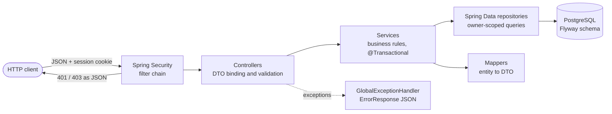
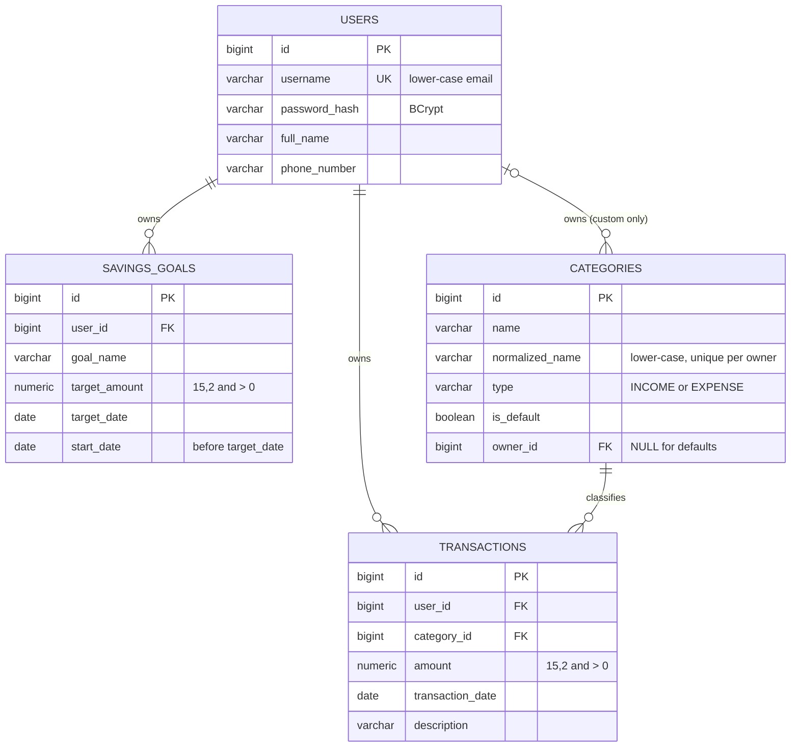

# Personal Finance Manager API

[](https://openjdk.org/projects/jdk/17/)
[](https://spring.io/projects/spring-boot)
[](https://spring.io/projects/spring-security)
[](https://www.postgresql.org/)
[](https://flywaydb.org/)
[](https://maven.apache.org/)
[](https://junit.org/junit5/)

A REST API for managing personal finances: record income and expenses, organise them into categories, track savings goals, and produce monthly and yearly reports. Users authenticate with server-side sessions, and every user can see and change only their own data.

The service is a single Spring Boot application backed by PostgreSQL. Its schema is managed by Flyway, it is covered by 276 automated tests, and it is ready to deploy on Render.

```bash
# Quick start: Java 17, no database needed
SPRING_PROFILES_ACTIVE=h2 ./mvnw spring-boot:run      # API at http://localhost:8080/api
```

---

## Table of contents

- [Overview](#overview)
- [Features](#features)
- [Technology stack](#technology-stack)
- [Architecture](#architecture)
- [Design principles](#design-principles)
- [Getting started](#getting-started)
- [Configuration](#configuration)
- [Using the API](#using-the-api)
- [API reference](#api-reference)
- [Authentication and security](#authentication-and-security)
- [Financial calculations](#financial-calculations)
- [Error handling](#error-handling)
- [Database design](#database-design)
- [Testing](#testing)
- [Design decisions and trade-offs](#design-decisions-and-trade-offs)
- [Verification and fixes](#verification-and-fixes)
- [Deployment](#deployment)
- [Troubleshooting](#troubleshooting)
- [Limitations and future improvements](#limitations-and-future-improvements)
- [License](#license)

---

## Overview

**What it does.** The API answers three questions about a user's money:
- Where did it come from and where did it go? (transactions by category)
- How much did I save this month or year? (reports)
- How close am I to a target? (savings goals)

**Who it is for.** Individuals tracking their own finances through any HTTP client, such as a web or mobile front end, curl, or Postman. There is no bundled user interface; this repository is the backend.

**How it is built.** A layered Spring Boot monolith: Controller → Service → Repository → PostgreSQL.
- Request and response bodies are dedicated DTOs (Java records).
- Business rules live in transactional services.
- Totals are aggregated in SQL.
- The schema is versioned with Flyway, and database constraints back up the application-level checks.

## Features

| Feature | Description |
| --- | --- |
| **Authentication** | Registration with validated email, password, name and phone. Login creates a server-side session (`JSESSIONID` cookie); logout invalidates it. Passwords are stored as BCrypt hashes. |
| **Transactions** | Create, list, update and delete income or expense entries. The type (INCOME/EXPENSE) is derived from the category. Dates cannot be in the future and cannot be changed after creation. |
| **Filtering** | List transactions by date range, category id, category name and type, in any combination, newest first. |
| **Categories** | Seven predefined categories shared by all users, plus custom categories per user. Defaults cannot be deleted, and a category in use cannot be deleted. |
| **Savings goals** | Goals with a target amount and date. Progress is calculated live from transactions since the goal's start date, including percentage complete and amount remaining. |
| **Reports** | Monthly and yearly income and expenses per category, plus net savings. |
| **Data isolation** | Every query is scoped to the logged-in user. Owner ids sent by the client are never trusted. |
| **Validation and errors** | Bean Validation on every request, business-rule checks in services, and one consistent JSON error format for every 4xx/5xx, including security errors. |
| **API docs** | OpenAPI spec at `/v3/api-docs` and Swagger UI at `/swagger-ui.html`. |
| **Testing** | 276 unit and integration tests, JaCoCo coverage with an enforced 80% line threshold, and a curl-based smoke-test script. |

## Technology stack

| Concern | Technology |
| --- | --- |
| Language | Java 17 |
| Framework | Spring Boot 3.5.16: Spring Web, Spring Security 6.5, Spring Data JPA (Hibernate 6.6), Bean Validation, Actuator |
| Database | PostgreSQL in production; H2 in PostgreSQL compatibility mode for tests and the zero-setup `h2` profile |
| Schema migrations | Flyway (Hibernate only validates the schema, it never generates it) |
| API documentation | springdoc-openapi 2.8 |
| Testing | JUnit 5, Mockito, Spring Boot Test, MockMvc, Spring Security Test, AssertJ |
| Coverage | JaCoCo 0.8.12 with a build-breaking 80% line-coverage rule |
| Build | Maven 3.9.9 via the included Maven Wrapper (`./mvnw`) |
| Deployment | Multi-stage `Dockerfile` (Temurin 17 JRE, non-root user) and a Render Blueprint (`render.yaml`) |

## Architecture



| Layer | Responsibility |
| --- | --- |
| **Security** (`config/SecurityConfig`, `security/*`) | Session authentication, public vs protected routes, cookie settings, CSRF option, JSON 401/403 responses (`SecurityErrorHandler`), session creation and teardown (`SessionAuthenticationHandler`) |
| **Controllers** (`controller/*`) | Map HTTP to Java only: bind and validate request DTOs, take the user id from the session principal, call one service method, return a response DTO and status code |
| **Services** (`service/*`) | Business rules, ownership checks and transaction boundaries. `GoalProgressCalculator` is the single place goal progress is computed |
| **Repositories** (`repository/*`) | Spring Data JPA queries, every one scoped to an owner. `TransactionSpecifications` builds the dynamic list filter; `projection/*` holds the aggregation results |
| **Entities** (`entity/*`) | `User`, `Category`, `Transaction`, `SavingsGoal` mapped to the Flyway tables. Entities never leave the service layer |
| **DTOs** (`dto/*`) | Immutable request/response records. Inputs are normalised in their constructors (trimmed, emails lower-cased) before validation |
| **Exception handling** (`exception/*`) | `GlobalExceptionHandler` turns every exception into an `ErrorResponse` with the right status code |
| **Migrations** (`resources/db/migration`) | `V1`–`V4` create the schema and seed the default categories |
| **Tests** (`src/test/java`) | Unit tests with Mockito, full-stack MockMvc tests, real-HTTP tests on a random port, and JPA tests on the migrated schema |

### Project structure

```text
.
├── Dockerfile                     # multi-stage build, Temurin 17 JRE, non-root user
├── render.yaml                    # Render Blueprint: web service + PostgreSQL
├── .env.example                   # placeholder environment variables
├── pom.xml
├── scripts/
│   └── api_smoke_test.sh          # end-to-end curl checks against a running instance
└── src/
    ├── main/
    │   ├── java/com/example/finance/
    │   │   ├── FinanceApplication.java
    │   │   ├── config/            # SecurityConfig, AppProperties, TimeConfig (Clock), WebConfig,
    │   │   │                      # OpenApiConfig, RequestSizeLimitFilter
    │   │   ├── security/          # CustomUserDetails(Service), SessionAuthenticationHandler, SecurityErrorHandler
    │   │   ├── controller/        # Auth, Transaction, Category, Goal, Report controllers
    │   │   ├── service/           # Auth, Transaction, Category, Goal, Report services,
    │   │   │                      # GoalProgressCalculator, GoalProgress
    │   │   ├── repository/        # User, Category, Transaction, SavingsGoal repositories,
    │   │   │                      # TransactionSpecifications, projection/
    │   │   ├── entity/            # User, Category, Transaction, SavingsGoal, enums/TransactionType
    │   │   ├── dto/               # auth, transaction, category, goal, report, common, validation
    │   │   ├── mapper/            # TransactionMapper, CategoryMapper, SavingsGoalMapper
    │   │   ├── exception/         # GlobalExceptionHandler, ErrorResponse, domain exceptions
    │   │   └── util/              # MonetaryAmounts, SupportedDateRange, InputNormalizer
    │   └── resources/
    │       ├── application.yml    # production defaults, all values overridable by env vars
    │       ├── application-local.yml
    │       ├── application-h2.yml
    │       └── db/migration/      # V1__create_users … V4__create_savings_goals
    └── test/
        ├── java/com/example/finance/
        │   ├── integration/       # MockMvc and real-HTTP API tests
        │   ├── service/           # Mockito unit tests
        │   ├── repository/        # @DataJpaTest on the Flyway schema
        │   ├── security/  exception/  util/
        │   └── support/           # test base class, fixed clock, database cleaner
        └── resources/application-test.yml
```

## Design principles

### SOLID, with concrete examples

| Principle | How it shows up in the code |
| --- | --- |
| **Single responsibility** | Controllers only translate HTTP, services own the business rules, repositories own the queries, mappers own conversion. Session mechanics (`SessionAuthenticationHandler`) and security-layer errors (`SecurityErrorHandler`) each have their own class, and goal progress is computed in exactly one place (`GoalProgressCalculator`). |
| **Open/closed** | Each transaction filter is an independent `Specification` predicate, so a new filter adds one predicate and no new query method. Monthly and yearly reports share one aggregation routine parameterised by date range (`ReportService`). |
| **Liskov substitution** | Inheritance is used only where subtypes honour the parent contract: domain exceptions extend `RuntimeException`, and `CustomUserDetails` is a drop-in `UserDetails`. There are no entity inheritance hierarchies. |
| **Interface segregation** | No broad catch-all service interfaces. Classes implement narrow framework interfaces (`UserDetailsService`, `AuthenticationEntryPoint`, `AccessDeniedHandler`), and repositories expose only the queries their callers use. |
| **Dependency inversion** | Services receive their collaborators instead of building them: `Clock` for "today", `PasswordEncoder`, `AuthenticationManager`, `SecurityContextRepository`. Everything is constructor-injected into `final` fields, which is what makes the Mockito unit tests possible. |

### Other principles applied

- **Fail fast:** invalid input is rejected at the boundary with a 400 and never reaches the database.
- **The database is the final authority:** unique, check and foreign-key constraints back up every important rule. Races that slip past the service checks are stopped by the database and mapped to 409 or 400.
- **Secure by default:** every business endpoint needs a session; cookies are HttpOnly and SameSite=Strict (and Secure in production); no CORS is published; owners always come from the session, never the request.
- **DRY without over-generalising:** each shared rule lives in one class: `MonetaryAmounts` (money scale and rounding), `SupportedDateRange` (date bounds), `InputNormalizer` (input canonicalisation).
- **KISS / YAGNI:** one deployable service with no caches, message brokers or speculative abstractions. Services are concrete classes because no second implementation is foreseeable.
- **Exact money:** `BigDecimal` in Java and `NUMERIC(15,2)` in the database; floating point is never used for amounts.

## Getting started

### Prerequisites

| Tool | Version | Needed for | Check |
| --- | --- | --- | --- |
| JDK | 17 or later | Building and running | `java -version` |
| Maven | none required | `./mvnw` downloads Maven 3.9.9 automatically | `./mvnw -v` |
| Git | any recent | Cloning | `git --version` |
| PostgreSQL | 13 or later | Only for the PostgreSQL setup (not for the `h2` profile or the tests) | `psql --version` |

### 1. Clone the repository

```bash
git clone https://github.com/techbhuvi04/Personal-Financial-Management.git
cd Personal-Financial-Management
```

### 2a. Run with H2 (zero setup)

The `h2` profile uses an in-memory database with the same Flyway migrations. Data is lost when the app stops.

```bash
SPRING_PROFILES_ACTIVE=h2 ./mvnw spring-boot:run
```

### 2b. Run with PostgreSQL

Create a database and a user (use your own password):

```bash
psql -d postgres -c "CREATE USER finance WITH PASSWORD 'change-me';"
psql -d postgres -c "CREATE DATABASE finance OWNER finance;"
```

Provide the connection settings and start the app with the `local` profile, which allows the session cookie over plain HTTP:

```bash
export DB_URL=jdbc:postgresql://localhost:5432/finance
export DB_USERNAME=finance
export DB_PASSWORD=change-me
SPRING_PROFILES_ACTIVE=local ./mvnw spring-boot:run
```

Spring Boot does not read `.env` files. If you copy `.env.example` to `.env`, load it into your shell first with `set -a; source .env; set +a`.

To build and run the packaged jar instead:

```bash
./mvnw clean package
SPRING_PROFILES_ACTIVE=local java -jar target/personal-finance-manager.jar
```

### 3. Confirm it is running

```bash
curl http://localhost:8080/actuator/health
# {"status":"UP","groups":["liveness","readiness"]}
```

- **API base URL:** `http://localhost:8080/api`
- **Swagger UI:** `http://localhost:8080/swagger-ui.html`

### Database migrations

Flyway runs automatically at startup. There is no separate migration command.
- **On an empty database**, `V1`–`V4` create the tables and seed the 7 default categories.
- **On later starts**, Flyway checks the recorded migrations and applies only new ones, so the seed data is never duplicated.
- **If Hibernate reports a schema mismatch**, startup fails rather than altering the schema, because Hibernate runs in `validate` mode.

Applied migrations must never be edited. Add a new `V5__...sql` instead. See [Troubleshooting](#troubleshooting) for migration errors.

## Configuration

Every deployment-specific value is an environment variable with a safe default. All variables are optional; the defaults in the table apply when one is unset. `.env.example` lists them all with placeholder values.

| Variable | Default | Description | Example |
| --- | --- | --- | --- |
| `SPRING_PROFILES_ACTIVE` | none (production settings) | `local` = PostgreSQL over plain HTTP; `h2` = in-memory database | `local` |
| `DB_URL` | built from `DB_HOST`/`DB_PORT`/`DB_NAME` | Full JDBC URL. Takes precedence when set. | `jdbc:postgresql://localhost:5432/finance` |
| `DB_HOST` | `localhost` | Database host, used when `DB_URL` is unset | `db.internal` |
| `DB_PORT` | `5432` | Database port | `5432` |
| `DB_NAME` | `finance` | Database name | `finance` |
| `DB_USERNAME` | `finance` | Database user | `finance` |
| `DB_PASSWORD` | empty | Database password | `change-me` |
| `DB_POOL_MAX_SIZE` | `5` | Maximum connection-pool size | `10` |
| `DB_POOL_MIN_IDLE` | `1` | Minimum idle connections | `1` |
| `PORT` | `8080` | HTTP port (hosting platforms usually set this) | `8081` |
| `COOKIE_SECURE` | `true` (`false` in `local` and `h2`) | `Secure` flag on the session cookie; keep `true` behind HTTPS | `true` |
| `COOKIE_SAME_SITE` | `strict` | `SameSite` attribute of the session cookie | `strict` |
| `SESSION_TIMEOUT` | `30m` | Idle session timeout | `1h` |
| `SESSION_COOKIE_NAME` | `JSESSIONID` | Session cookie name | `JSESSIONID` |
| `APP_TIME_ZONE` | `UTC` | Time zone that defines "today" for date rules | `Asia/Kolkata` |
| `CSRF_ENABLED` | `false` | Require a CSRF token on state-changing requests (see [CSRF](#csrf)) | `true` |
| `MAX_REQUEST_SIZE` | `16KB` | Larger request bodies are rejected with 413 | `16KB` |
| `API_DOCS_ENABLED` | `true` | Serve Swagger UI and `/v3/api-docs` | `false` |

## Using the API

The API uses **session cookies**. Log in once, save the cookie, and send it with every later request. With curl, `-c` saves cookies to a file and `-b` sends them. The responses below are real output from the application.

```bash
BASE=http://localhost:8080/api

# Register (public)
curl -s -X POST $BASE/auth/register -H 'Content-Type: application/json' \
  -d '{"username":"user@example.com","password":"password123","fullName":"John Doe","phoneNumber":"+1234567890"}'
# {"message":"User registered successfully","userId":1}

# Log in and save the session cookie
curl -s -c cookies.txt -X POST $BASE/auth/login -H 'Content-Type: application/json' \
  -d '{"username":"user@example.com","password":"password123"}'
# {"message":"Login successful"}

# Use the session for everything else
curl -s -b cookies.txt -X POST $BASE/transactions -H 'Content-Type: application/json' \
  -d '{"amount":50000.00,"date":"2024-01-15","category":"Salary","description":"January Salary"}'
# {"id":1,"amount":50000.00,"date":"2024-01-15","category":"Salary","description":"January Salary","type":"INCOME"}

curl -s -b cookies.txt "$BASE/transactions?startDate=2024-01-01&endDate=2024-01-31&type=EXPENSE"
curl -s -b cookies.txt $BASE/reports/monthly/2024/1

# Log out: the session is invalidated and the same cookie now gets 401
curl -s -b cookies.txt -X POST $BASE/auth/logout
# {"message":"Logout successful"}
```

## API reference

All bodies are JSON; dates use `yyyy-MM-dd`; monetary values have two decimal places (zero is written as `0`). Interactive documentation is at `/swagger-ui.html`.

### Endpoints

#### Authentication

| Method | Endpoint | Auth | Description | Success | Errors |
| --- | --- | --- | --- | --- | --- |
| `POST` | `/api/auth/register` | Public | Create an account | 201 | 400, 409 |
| `POST` | `/api/auth/login` | Public | Start a session (sets `JSESSIONID`) | 200 | 400, 401 |
| `POST` | `/api/auth/logout` | Session | Invalidate the session | 200 | 401 |
| `GET` | `/api/auth/csrf` | Public | CSRF token for browser clients (only used when `CSRF_ENABLED=true`) | 200 | none |

#### Transactions

| Method | Endpoint | Auth | Description | Success | Errors |
| --- | --- | --- | --- | --- | --- |
| `POST` | `/api/transactions` | Session | Create a transaction | 201 | 400, 401 |
| `GET` | `/api/transactions` | Session | List own transactions, newest first, with optional filters | 200 | 400, 401 |
| `PUT` | `/api/transactions/{id}` | Session | Update amount, category or description (the date is never changed) | 200 | 400, 401, 404 |
| `DELETE` | `/api/transactions/{id}` | Session | Delete a transaction | 200 | 401, 404 |

#### Categories

| Method | Endpoint | Auth | Description | Success | Errors |
| --- | --- | --- | --- | --- | --- |
| `GET` | `/api/categories` | Session | Default categories plus own custom categories | 200 | 401 |
| `POST` | `/api/categories` | Session | Create a custom category | 201 | 400, 401, 409 |
| `DELETE` | `/api/categories/{name}` | Session | Delete an unused custom category (name is case-insensitive) | 200 | 400, 401, 403, 404 |

#### Savings goals

| Method | Endpoint | Auth | Description | Success | Errors |
| --- | --- | --- | --- | --- | --- |
| `POST` | `/api/goals` | Session | Create a goal | 201 | 400, 401 |
| `GET` | `/api/goals` | Session | List own goals with live progress | 200 | 401 |
| `GET` | `/api/goals/{id}` | Session | Get one goal with live progress | 200 | 400, 401, 403, 404 |
| `PUT` | `/api/goals/{id}` | Session | Update target amount and/or target date | 200 | 400, 401, 403, 404 |
| `DELETE` | `/api/goals/{id}` | Session | Delete a goal (transactions are unaffected) | 200 | 401, 403, 404 |

#### Reports

| Method | Endpoint | Auth | Description | Success | Errors |
| --- | --- | --- | --- | --- | --- |
| `GET` | `/api/reports/monthly/{year}/{month}` | Session | Income and expenses per category for one month | 200 | 400, 401 |
| `GET` | `/api/reports/yearly/{year}` | Session | Income and expenses per category for one year | 200 | 400, 401 |

#### Operations

| Method | Endpoint | Auth | Description |
| --- | --- | --- | --- |
| `GET` | `/actuator/health` | Public | Health check (`{"status":"UP",...}`) |
| `GET` | `/swagger-ui.html`, `/v3/api-docs` | Public | API documentation (disable with `API_DOCS_ENABLED=false`) |

### Authentication endpoints

```http
POST /api/auth/register
Content-Type: application/json

{"username":"user@example.com","password":"password123","fullName":"John Doe","phoneNumber":"+1234567890"}
```
```json
{"message":"User registered successfully","userId":1}
```

| Field | Rules |
| --- | --- |
| `username` | Valid email, at most 254 characters. Trimmed and lower-cased, unique case-insensitively (409 if taken). |
| `password` | 8–72 characters and at most 72 UTF-8 bytes (BCrypt's limit), with at least one letter and one digit and no whitespace |
| `fullName` | Up to 100 characters: letters, spaces, `.` `'` `-`, starting with a letter |
| `phoneNumber` | Optional `+` followed by 7–15 digits. Spaces, dashes, dots and parentheses are removed first. |

`POST /api/auth/login` with `{"username": "...", "password": "..."}` returns `{"message":"Login successful"}` and a `Set-Cookie: JSESSIONID=...; HttpOnly; SameSite=Strict` header. A wrong password and an unknown email return the same 401, so the API doesn't reveal which accounts exist.

### Transaction endpoints

**Create:**

```http
POST /api/transactions

{"amount":50000.00,"date":"2024-01-15","category":"Salary","description":"January Salary"}
```
```json
{"id":1,"amount":50000.00,"date":"2024-01-15","category":"Salary","description":"January Salary","type":"INCOME"}
```

- `amount`: required, greater than 0, at most 13 integer digits and 2 decimal places.
- `date`: required, `yyyy-MM-dd`, between 1900-01-01 and today (in `APP_TIME_ZONE`).
- `category`: required. The **name** of a default category or one of your custom categories, matched case-insensitively.
- `description`: optional, up to 255 characters. Blank values are stored as `null`.
- `type`: optional. It is always derived from the category; if you send it and it doesn't match, the response is 400.

**List and filter:** results are sorted newest date first, then newest id first, and returned as `{"transactions":[...]}`. All query parameters are optional and combined with AND.

| Parameter | Example | Meaning |
| --- | --- | --- |
| `startDate` | `2024-01-01` | On or after this date (inclusive) |
| `endDate` | `2024-01-31` | On or before this date (inclusive); must not be before `startDate` |
| `categoryId` | `3` | Category id, as returned by `GET /api/categories` |
| `category` | `Rent` | Category name, case-insensitive |
| `type` | `EXPENSE` | `INCOME` or `EXPENSE`, any case |

```http
GET /api/transactions?startDate=2024-01-01&endDate=2024-01-31&type=EXPENSE
```
```json
{"transactions":[{"id":2,"amount":1200.00,"date":"2024-01-16","category":"Rent","description":null,"type":"EXPENSE"}]}
```

**Update:** this is a partial update. Only the fields you send change. The date is read-only, so a `date` in the body is ignored:

```http
PUT /api/transactions/1

{"amount":60000.00,"description":"Updated January Salary","date":"2024-02-01"}
```
```json
{"id":1,"amount":60000.00,"date":"2024-01-15","category":"Salary","description":"Updated January Salary","type":"INCOME"}
```

**Delete:** `DELETE /api/transactions/{id}` returns `{"message":"Transaction deleted successfully"}`. Another user's transaction id returns 404, which also avoids revealing that it exists.

### Category endpoints

```http
POST /api/categories

{"name":"SideBusinessIncome","type":"INCOME"}
```
```json
{"id":8,"name":"SideBusinessIncome","type":"INCOME","isCustom":true,"custom":true}
```

`GET /api/categories` returns `{"categories":[...]}`: the 7 defaults first (Salary as INCOME; Food, Rent, Transportation, Entertainment, Healthcare and Utilities as EXPENSE), then your custom categories. The custom flag appears as both `isCustom` (from the assignment's API specification) and `custom` (the field the assignment's grading script reads).

- **Custom names:** 1–50 characters (letters, digits, spaces and `_ . & ' -`). Unique per user, case-insensitively, and may not reuse a default name. A clash returns 409.
- **Deleting a default category:** 403 `{"message":"Default categories cannot be deleted"}`.
- **Deleting a category used by a transaction:** 400. Transactions are never cascade-deleted.
- **Deleting a name you don't own:** 404. This includes another user's category.

### Savings-goal endpoints

```http
POST /api/goals

{"goalName":"Emergency Fund","targetAmount":100000.00,"targetDate":"2027-01-01","startDate":"2024-01-01"}
```
```json
{"id":1,"goalName":"Emergency Fund","targetAmount":100000.00,"targetDate":"2027-01-01","startDate":"2024-01-01","currentProgress":58800.00,"progressPercentage":58.8,"remainingAmount":41200.00}
```

- `goalName`: required, up to 100 characters.
- `targetAmount`: required, greater than 0, 2 decimal places.
- `targetDate`: required, after today and no later than 9999-12-31.
- `startDate`: optional, defaults to today. It can't be in the future or before 1900-01-01.
- **Update:** `PUT /api/goals/{id}` accepts `targetAmount` and/or `targetDate`, and progress is recalculated in the response. Other fields are ignored.

  ```json
  {"id":1,"goalName":"Emergency Fund","targetAmount":120000.00,"targetDate":"2027-01-01","startDate":"2024-01-01","currentProgress":58800.00,"progressPercentage":49.0,"remainingAmount":61200.00}
  ```
- **Other endpoints:** `GET /api/goals` returns `{"goals":[...]}`. `DELETE /api/goals/{id}` returns `{"message":"Goal deleted successfully"}`. Another user's goal returns 403.

### Report endpoints

```http
GET /api/reports/monthly/2024/1
```
```json
{"month":1,"year":2024,"totalIncome":{"Salary":60000.00},"totalExpenses":{"Rent":1200.00},"netSavings":58800.00}
```
```http
GET /api/reports/yearly/2023
```
```json
{"year":2023,"totalIncome":{},"totalExpenses":{},"netSavings":0}
```

`month` must be 1–12 and `year` 1900–9999; anything else returns 400. Category keys are sorted alphabetically, ignoring case.

## Authentication and security

| Aspect | Implementation |
| --- | --- |
| **Sessions** | Login authenticates through Spring Security's `AuthenticationManager` and stores the security context in the server-side `HttpSession`. If a session already existed, its id changes on login (session-fixation protection). The idle timeout is `SESSION_TIMEOUT` (30 minutes by default). |
| **Cookie** | `JSESSIONID` with `HttpOnly; SameSite=Strict`, plus `Secure` when `COOKIE_SECURE=true` (the production default). Behind Render's HTTPS proxy, forwarded headers are honoured. |
| **Logout** | Invalidates the session, clears the security context and expires the cookie. Reusing the old cookie returns 401. |
| **Protected routes** | Everything except register, login, `/api/auth/csrf`, `/actuator/health` and the API docs. Unauthenticated calls get a JSON 401, never a redirect or HTML. |
| **Passwords** | BCrypt-hashed and never logged or returned. Passwords over 72 bytes are rejected, because BCrypt ignores everything after byte 72. |
| **Data isolation** | Every repository query filters by the session user's id. Request bodies cannot set an owner or id. Reports and goal progress only include the caller's transactions. |
| **Other hardening** | No CORS grants; JSON-only request bodies (other content types get 415); request bodies over `MAX_REQUEST_SIZE` get 413; error messages never include SQL, stack traces or class names. |

### CSRF

Session cookies are vulnerable to cross-site request forgery. These defences are **always on**:
- the `SameSite=Strict` cookie
- no CORS configuration
- JSON-only request bodies

Token-based CSRF protection is **optional** (`CSRF_ENABLED`, default `false`). Non-browser clients such as curl and the assignment's grading script can't fetch and echo a token, and the assignment's API contract has no token field. Enable it when a browser front end uses the API:

1. Call `GET /api/auth/csrf`. It returns `{"csrfEnabled":true,"headerName":"X-XSRF-TOKEN","token":"..."}` and sets an `XSRF-TOKEN` cookie.
2. Send the token in the `X-XSRF-TOKEN` header on every `POST`, `PUT` and `DELETE` (register and login are exempt).
3. A missing or invalid token gets 403 `{"message":"Missing or invalid CSRF token"}`.

## Financial calculations

```text
Net savings          = total income − total expenses                       (reports)
Goal progress        = income − expenses, dated startDate through today    (savings goals)
Progress percentage  = goal progress ÷ target amount × 100
Remaining amount     = target amount − goal progress
```

**Worked example** (the responses above): income of 60,000.00 and expenses of 1,200.00 since 2024-01-01.

| Target amount | Goal progress | Progress percentage | Remaining amount |
| --- | --- | --- | --- |
| 100,000.00 | 58,800.00 | 58.8 | 41,200.00 |
| 120,000.00 | 58,800.00 | 49.0 | 61,200.00 |

**Date boundaries:**
- A transaction dated exactly on a goal's `startDate` counts towards it.
- A monthly report covers `[first day of the month, first day of the next month)`, and a yearly report `[1 January, 1 January of the next year)`. Month ends, year ends and 29 February are handled exactly.
- Reports use the transaction date, never the time the record was created.

**Rounding and format:**
- All amounts are `BigDecimal`, rounded HALF_UP to 2 decimal places.
- Zero is written as `0`; non-zero amounts always have two decimals (`58800.00`).
- The percentage is rounded HALF_UP to 2 decimals and written as a plain number (`58.8`, `16.67`, `0.0`).

**No capping:**
- If expenses exceed income, progress and the percentage are negative.
- If the target is exceeded, the percentage is above 100 and the remaining amount is negative.
- Clamp to 0–100% in the client if a progress bar needs it.

**Always current:** progress is never stored. It is recalculated from transactions on every read, so edits and deletions show up immediately, and the goal list and goal detail always agree because both use `GoalProgressCalculator`.

## Error handling

Every error, whether raised by validation, a service, or the security filter chain, uses one JSON format (`ErrorResponse`). This is a real validation error:

```json
{"status":400,"error":"Bad Request","message":"Amount must be greater than zero","path":"/api/transactions","timestamp":"2026-10-10T10:09:21.632477Z","fieldErrors":{"amount":"Amount must be greater than zero"}}
```

This is a real authentication error:

```json
{"status":401,"error":"Unauthorized","message":"Authentication required: log in to obtain a valid session","path":"/api/transactions","timestamp":"2026-10-10T10:09:21.712280Z"}
```

`fieldErrors` appears only for request-body validation failures.

| Status | Meaning in this API |
| --- | --- |
| 200 OK | Successful read, update, delete, login or logout |
| 201 Created | Account, transaction, category or goal created |
| 400 Bad Request | Validation failure, malformed JSON, invalid date/number/enum, future transaction date, unknown category, type mismatch, category in use, invalid month or year |
| 401 Unauthorized | No session, expired or invalidated session, or wrong credentials at login |
| 403 Forbidden | Another user's goal, deleting a default category, or a missing CSRF token (when enabled) |
| 404 Not Found | Unknown or another user's transaction, unknown goal, unknown custom category, unknown endpoint |
| 409 Conflict | Email already registered, duplicate category name, or the resource was changed or deleted by a concurrent request |
| 405 / 406 / 413 / 415 | Wrong HTTP method, non-JSON `Accept`, body too large, non-JSON `Content-Type` |
| 503 Service Unavailable | Database unreachable |

## Database design



All four tables also have audit timestamps (`created_at`; `updated_at` everywhere except `categories`).

| Table | Purpose and integrity rules |
| --- | --- |
| `users` | One row per account. Unique, lower-case `username`; password stored only as a BCrypt hash. |
| `categories` | Defaults have `owner_id = NULL` and `is_default = TRUE`, a pairing enforced by a CHECK constraint. Custom categories are unique per `(owner_id, normalized_name)`, which gives case-insensitive uniqueness that works on both PostgreSQL and H2. |
| `transactions` | `amount > 0` CHECK. The foreign key to `categories` has no cascade, so a category still in use cannot be deleted. The type is not stored; it is always the category's type. Indexes on `(user_id, transaction_date)`, `(user_id, category_id)` and `(category_id)`. |
| `savings_goals` | `target_amount > 0` and `start_date < target_date` CHECKs; indexed by `user_id`. Progress is computed, never stored. |

**Migrations:** Flyway owns the schema and Hibernate only validates against it:
- `V1__create_users.sql`
- `V2__create_categories.sql`, which also seeds the 7 default categories
- `V3__create_transactions.sql`
- `V4__create_savings_goals.sql`

The same scripts run on PostgreSQL and on H2.

## Testing

```bash
./mvnw test                          # unit + integration tests (in-memory H2, no setup needed)
./mvnw verify                        # tests + JaCoCo report + fails the build below 80% line coverage
open target/site/jacoco/index.html   # coverage report (use xdg-open on Linux)

# End-to-end checks against a running instance
bash scripts/api_smoke_test.sh http://localhost:8080/api
bash financial_manager_tests.sh http://localhost:8080/api   # grading script supplied with the assignment
```

`financial_manager_tests.sh` is not part of this repository; it is linked from the assignment brief.

**Latest results on this code:**

| Check | Result |
| --- | --- |
| `./mvnw clean verify` | BUILD SUCCESS: 276 tests, 0 failures, 0 errors, 0 skipped |
| JaCoCo coverage | 98.3% line, 90.6% branch (only `FinanceApplication.main` is excluded) |
| Assignment grading script (local PostgreSQL and `h2` profile) | 86/86 passed |
| `scripts/api_smoke_test.sh` | 68/68 passed |

**What the suites cover:**

| Test class(es) | Focus |
| --- | --- |
| `service/*Test` | Mockito unit tests of business rules: date rules, type checks, ownership, duplicate handling, report and goal arithmetic |
| `GoalProgressTest`, `FinancialCalculationIntegrationTest` | Hand-computed figures: zero, negative, exactly 100% and above-100% progress; repeating decimals; precision limits; month, year and leap-year boundaries |
| `AuthIntegrationTest`, `SessionCookieIntegrationTest`, `ProductionCookieIntegrationTest`, `CsrfEnabledIntegrationTest`, `SecurityHardeningIntegrationTest` | Registration and login validation, cookie attributes, session fixation, logout, forged cookies, CSRF mode, CORS, passwords never in responses or logs |
| `TransactionIntegrationTest`, `CategoryIntegrationTest`, `GoalIntegrationTest`, `ReportIntegrationTest` | Full HTTP contract for each resource, including cross-user isolation |
| `InputBoundaryIntegrationTest`, `ErrorHandlingIntegrationTest` | Malformed input, date limits, 72-byte passwords, ignored owner ids, rejected writes persisting nothing, 405/406/413/415 |
| `AssignmentContractIntegrationTest` | Replays the grading script's scenarios with exact JSON text checks |
| `ConcurrencyIntegrationTest`, `ConcurrentModificationIntegrationTest` | Parallel registrations and category creation; update/delete races over real HTTP (never a 5xx, never an orphaned transaction) |
| `RepositoryIntegrationTest` | Seed data, database constraints, aggregation queries and filters on the Flyway schema |

The tests fix the business clock at 2026-10-10 UTC (`TestClockConfig`) and clear user data after each test, so they don't depend on the real date or on execution order.

## Design decisions and trade-offs

### Decisions where the assignment was open

1. **Another user's resources:**
   - **Goals:** 403, as the assignment lists for goal endpoints.
   - **Transactions:** 404; the assignment lists only 404 for them, and it also hides whether an id exists.
   - **Custom categories:** 404, because category names are per user.
2. **Deleting categories:** a default category gives 403, and a category still in use gives 400, since 409 isn't in that endpoint's documented statuses.
3. **Category by name and by id:** transactions are created with a category **name** (as the assignment specifies), but can be filtered by `categoryId` or `category`. That's why category responses include an `id`.
4. **Transaction date:** read-only. A `date` sent in an update is ignored rather than rejected, because the assignment's grading script expects a 2xx with the original date.
5. **Output formats:** `progressPercentage` is a plain number, zero amounts are `0`, and categories carry `custom` alongside `isCustom`. These match the grading script's exact text comparisons.
6. **Supported dates:** every business date must be within 1900-01-01..9999-12-31, so anything stored can also be reported.
7. **Concurrency:** database constraints are the final safeguard, and races are reported as 409/400, never 500. Writing a transaction briefly locks its **custom** category, so a concurrent delete can't leave a transaction pointing at a deleted category, even on H2, whose foreign-key checks don't lock the parent row.

### Trade-offs

| Decision | Benefit | Cost |
| --- | --- | --- |
| Server-side sessions (required by the assignment) instead of JWT | Logout really revokes access; no token handling in clients | Sessions live in memory, so a restart logs users out and multiple instances need a shared session store |
| Token CSRF off by default | curl and the grading script work without a token | Browser front ends should enable it; the cookie and CORS defences still apply |
| Goal progress computed on every read | Never stale | One aggregate query per goal (1 + N for the goal list) |
| Transaction type derived from the category, not stored | Type and category can never disagree | Filtering by type needs a join |
| Hard delete of transactions | Simple; reports and goals drop deleted data automatically | No undo or audit history |
| Totals summed in SQL | Constant memory regardless of history size | Aggregation logic lives in JPQL |
| Flyway + Hibernate `validate` | Reproducible schema that can't drift | Migrations are written by hand, in SQL that runs on both PostgreSQL and H2 |
| H2 for the test suite | Fast, needs no Docker or database server | H2 differs from PostgreSQL under concurrency, so PostgreSQL behaviour was also verified against a real server |
| Ignoring `date` on updates | Matches the assignment's grading script | A client trying to change the date gets no error, only the unchanged date |
| No pagination | Matches the `{"transactions":[...]}` contract | Very large histories come back in one response |

## Verification and fixes

An audit ran the assignment's grading script and probed edge cases against real PostgreSQL. The first version passed its own tests but only **51 of 86** grading-script checks. Each defect below was reproduced with a failing test, then fixed. The grading script now passes **86/86**.

| # | Problem found | Fix |
| --- | --- | --- |
| 1 | The phone number `+0987654321` used by the grading script was rejected | Leading zero allowed after `+` |
| 2 | A transaction update containing `date` returned 400 | `date` is read-only and ignored |
| 3 | Category responses lacked the `custom` field | Output both `custom` and `isCustom` |
| 4 | Numbers didn't match the expected text (`65.50` vs `65.5`, `0.00` vs `0`) | Percentages as plain numbers, zero as `0` |
| 5 | **Security:** a different password sharing the first 72 bytes could log in (BCrypt truncation, CVE-2025-22228) | Byte-length validation, a check before login, and an upgrade to Spring Boot 3.5.16 / Spring Security 6.5 |
| 6 | An update or delete racing a delete returned 500 | Concurrent modification returns 409 |
| 7 | Year-1 and BC dates were accepted but couldn't be reported | One supported date range for every business date |
| 8 | On H2, deleting a category concurrently with creating a transaction could orphan the transaction | Row locks on custom categories |
| 9 | Report category order depended on database collation | Sorted case-insensitively in the application |

## Deployment

### Render (Blueprint)

The repository contains everything Render needs:
- **`render.yaml`** defines a Docker web service with a health check on `/actuator/health`, and a managed PostgreSQL database. It wires `DB_HOST`, `DB_PORT`, `DB_NAME`, `DB_USERNAME` and `DB_PASSWORD` from the database automatically and sets `COOKIE_SECURE=true`.
- **The `Dockerfile`** handles build and start. It builds with `mvn -B -DskipTests package` on a Maven/Temurin 17 image, and runs `java $JAVA_OPTS -jar /app/app.jar` on a Temurin 17 JRE as a non-root user. Render runs Java services through Docker, so there are no separate build or start commands to configure.

Steps:
1. Sign in to [Render](https://render.com) with the GitHub account that can access this repository.
2. Choose **New → Blueprint**, select the repository and click **Apply**. Render creates the database and the web service and builds the image.
3. **Migrations:** Flyway runs on every start. On the new, empty database it creates the schema and seeds the categories; it never drops or rewrites existing data.
4. **Verify:** when the service shows **Live**, open `https://YOUR_DEPLOYED_API_URL/actuator/health` and expect `{"status":"UP",...}`. Startup and request logs are in the service's **Logs** tab.
5. **Test the live API:**

   ```bash
   bash financial_manager_tests.sh https://YOUR_DEPLOYED_API_URL/api
   bash scripts/api_smoke_test.sh https://YOUR_DEPLOYED_API_URL/api
   ```

**HTTPS and cookies:** in production the session cookie is `Secure`, so clients only send it over HTTPS. Render terminates TLS, and the app honours the forwarded headers.

Free Render instances sleep when idle, so the first request after a pause can take about a minute.

### Without the Blueprint

Create a Docker web service from this repository and set `DB_URL` (or `DB_HOST`, `DB_PORT` and `DB_NAME`), `DB_USERNAME`, `DB_PASSWORD` and `COOKIE_SECURE=true`. Render's own connection string uses the `postgres://` format, which is not a JDBC URL; use the separate host, port and name variables instead.

### Other Docker hosts

```bash
docker build -t personal-finance-manager .
docker run -p 8080:8080 \
  -e DB_URL=jdbc:postgresql://HOST:5432/finance -e DB_USERNAME=finance -e DB_PASSWORD=change-me \
  personal-finance-manager
```

## Troubleshooting

| Symptom | Cause and fix |
| --- | --- |
| Build error `release version 17 not supported` | Your JDK is older than 17. Install JDK 17+ and point `JAVA_HOME` at it, then check with `java -version`. |
| Startup fails with `Connection to localhost:5432 refused` | PostgreSQL isn't running or the `DB_*` variables are wrong. Start PostgreSQL, check `DB_URL`/`DB_USERNAME`/`DB_PASSWORD`, or use the `h2` profile. |
| App connects to the wrong database or user | Without `DB_URL`, the defaults (`localhost:5432/finance`, user `finance`) apply. Export the `DB_*` variables in the same shell that starts the app; `.env` files are not read automatically. |
| `Port 8080 was already in use` | Another process holds the port. Stop it or start with `PORT=8081`. |
| Flyway `Validate failed` / checksum mismatch | An already-applied migration file was edited. Restore it and put the change in a new `V5__...sql`. For a disposable local database, drop and recreate it. |
| Hibernate `Schema-validation: missing column/table` | The database wasn't migrated by this project's Flyway scripts. Use an empty database and let Flyway create the schema. |
| Tests try to reach PostgreSQL | Tests use H2 through the `test` profile. Unset any `SPRING_DATASOURCE_*` environment variables, which override profile settings. |
| `401` right after logging in | The session cookie isn't being sent. Save it with `-c cookies.txt` on login and send it with `-b cookies.txt` on later requests. |
| Login works over `http://` but later requests get `401` | Without a profile, the cookie is `Secure`, and many clients only send Secure cookies over HTTPS. Use the `local` or `h2` profile (or `COOKIE_SECURE=false`) for plain-HTTP local runs. |
| `403 Missing or invalid CSRF token` | `CSRF_ENABLED=true` is set. Fetch a token from `GET /api/auth/csrf` and send it in the `X-XSRF-TOKEN` header, or leave CSRF at its default for API clients. |
| `415 Content type must be application/json` | Add `-H 'Content-Type: application/json'` to requests with a body. |

## Limitations and future improvements

**Current limitations:**
- Sessions are held in memory, so a restart or redeploy signs everyone out, and running several instances would need sticky sessions or a shared store.
- The transaction list is not paginated.
- There is no rate limiting on login, no password reset and no account deletion.
- Listing goals runs one aggregate query per goal, which is fine at personal scale.
- The request-size limit checks the declared `Content-Length`; chunked requests are still bounded by field-level validation.
- The assignment's grading script hard-codes dates (a "future" transaction on 2026-12-31 and goals ending 2027-01-01), so it stops passing for any implementation from 2026-12-31.

**Possible future improvements:**
- Pagination and sorting options for transactions.
- Login rate limiting (e.g. Bucket4j).
- A persistent, shared session store (Spring Session with JDBC or Redis).
- A CI pipeline running `./mvnw verify` on every push.
- PostgreSQL-backed integration tests (Testcontainers) alongside H2.
- Budgets per category and spending-trend reports.

## License

No license has been specified for this project yet. Until one is added, the default copyright rules apply. Open an issue on the repository for questions or problems.
